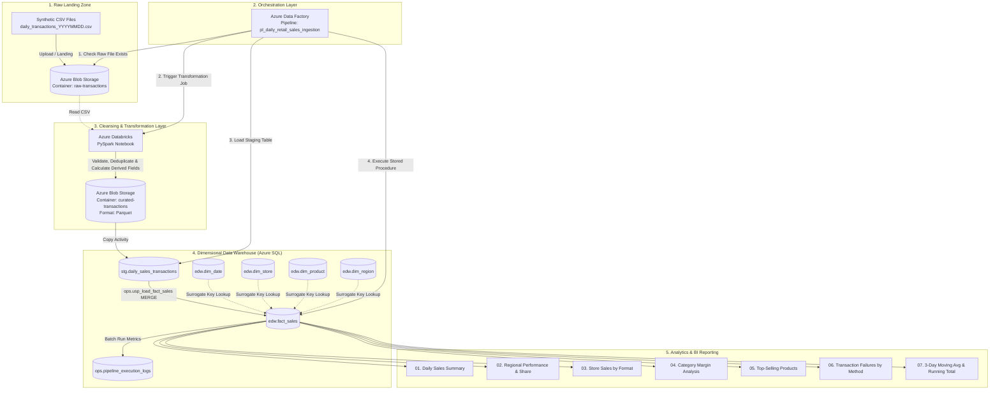
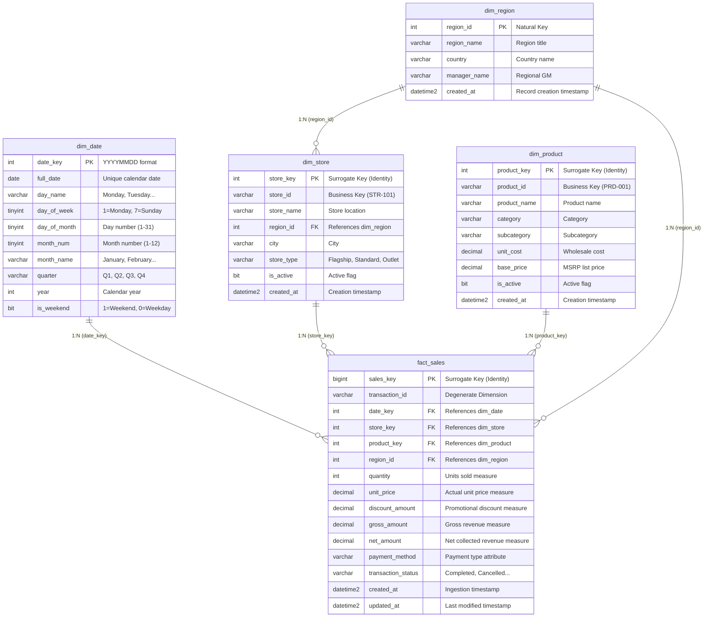

# Retail Data Warehouse & Automated BI Reporting Platform

[](https://azure.microsoft.com/services/data-factory/)
[](https://azure.microsoft.com/services/databricks/)
[](https://azure.microsoft.com/products/azure-sql/database/)
[]()
[](LICENSE)

A portfolio data engineering and BI operations project demonstrating an end-to-end cloud data pipeline. The platform ingests daily retail sales transactions, applies data validation and transformations using **Azure Databricks (PySpark)**, orchestrates workflows with **Azure Data Factory (ADF)**, loads curated data into an **Azure SQL** Star-Schema Data Warehouse, and delivers business reporting views.

> [!NOTE]
> **Portfolio Project Disclaimer**: This project uses **synthetic retail data** generated for portfolio demonstration and skill validation (Junior DevOps / Data Operations / BI Operations). It does not represent or belong to any real commercial organization or customer.

---

## Table of Contents
1. [Project Overview](#1-project-overview)
2. [Business Scenario](#2-business-scenario)
3. [Objectives](#3-objectives)
4. [Architecture](#4-architecture)
5. [Technology Stack](#5-technology-stack)
6. [Data Model (Star Schema)](#6-data-model-star-schema)
7. [Data Flow (ELT Pipeline)](#7-data-flow-elt-pipeline)
8. [Azure Data Factory Orchestration](#8-azure-data-factory-orchestration)
9. [Azure Databricks Data Transformation](#9-azure-databricks-data-transformation)
10. [Azure SQL Data Warehouse Design](#10-azure-sql-data-warehouse-design)
11. [Data Quality & Anomaly Handling](#11-data-quality--anomaly-handling)
12. [Business Reporting Queries](#12-business-reporting-queries)
13. [Setup & Deployment Instructions](#13-setup--deployment-instructions)
14. [Security & Safe Configuration](#14-security--safe-configuration)
15. [Running and Verifying the Pipeline](#15-running-and-verifying-the-pipeline)
16. [Sample Query Results](#16-sample-query-results)
17. [Operational Monitoring & Troubleshooting](#17-operational-monitoring--troubleshooting)
18. [Project Limitations](#18-project-limitations)
19. [Realistic Future Improvements](#19-realistic-future-improvements)

---

## 1. Project Overview
Retail organizations collect thousands of daily point-of-sale (POS) and online transactions across disparate store formats, products, and regional markets. Without centralized data pipelines, business stakeholders face dirty data, duplicate records, delayed revenue calculations, and fragmented reporting.

This project implements an automated, batch-oriented data platform on Microsoft Azure that:
- Ingests raw daily sales CSV files from cloud object storage.
- Cleanses, validates, deduplicates, and calculates core measures (`gross_amount`, `net_amount`).
- Loads clean data into a dimensional star schema in Azure SQL Database.
- Executes analytical queries and tracks batch pipeline execution telemetry.

---

## 2. Business Scenario
A hypothetical multi-region retail merchant receives daily sales transaction batches from physical stores (Flagship, Standard, Outlet) across North America, Europe, and Asia Pacific. 

The daily data operations requirement is to:
1. Automatically detect and ingest incoming daily transaction files.
2. Filter corrupt entries (e.g., negative quantities, malformed prices, unmapped statuses).
3. Deduplicate re-transmitted point-of-sale transactions.
4. Maintain a single source of truth data warehouse.
5. Provide daily business reports on regional performance, store-type revenue, category margins, payment failure rates, and moving sales averages.

---

## 3. Objectives
- **Demonstrate Data Operations & Ingestion**: Build automated batch pipelines with explicit retry policies, dependency checks, and audit logging.
- **Implement PySpark Transformations**: Cleanse raw semi-structured data, enforce strict schemas, coalesce null values, and calculate business measures.
- **Design a Star-Schema Warehouse**: Construct normalized dimensions and an indexed fact table with surrogate and natural keys.
- **Deliver Business Intelligence Queries**: Author optimized SQL queries leveraging CTEs, window functions (`DENSE_RANK`, `LAG`, `AVG() OVER`), and multi-table joins.
- **Ensure Data Quality**: Build pre-load validation gates to quarantine or reject malformed records.

---

## 4. Architecture



---

## 5. Technology Stack

| Technology | Role | Rationale |
| :--- | :--- | :--- |
| **Azure Blob Storage / ADLS Gen2** | Object Storage Landing Zone | Scalable, low-cost cloud storage for raw CSV files and partitioned curated Parquet datasets. |
| **Azure Data Factory (ADF)** | Pipeline Orchestration | Industry-standard cloud ETL/ELT orchestrator with native scheduling, parameterization, and monitoring. |
| **Azure Databricks (PySpark)** | Data Cleansing & Transformation | Distributed processing engine for schema enforcement, null handling, deduplication, and derived calculations. |
| **Azure SQL Database** | Relational Data Warehouse | ACID-compliant relational engine optimized for star-schema analytical queries and stored procedure automation. |
| **T-SQL** | Modeling & BI Analytics | Standard analytical SQL syntax for DDL, DML, idempotent `MERGE`, and windowed business queries. |
| **Python** | Synthetic Data Generation | Script to generate reproducible retail datasets with intentional edge-case anomalies for validation testing. |
| **Git / GitHub** | Source Control | Repository hosting code, schema migrations, and documentation. |

---

## 6. Data Model (Star Schema)

A **Star Schema** design is chosen because:
1. **Simplified Joins**: Slicing facts by dimensions requires direct 1-to-many joins rather than complex snowflake/3NF chains.
2. **High Query Performance**: Facilitates fast aggregations across dates, stores, products, and regions.
3. **BI Tool Compatibility**: Direct mapping to BI tools (Power BI, Tableau) for dimensional hierarchies.



---

## 7. Data Flow (ELT Pipeline)

| Pipeline Stage | Platform | Description |
| :--- | :--- | :--- |
| **1. Source** | Synthetic Script / POS Simulator | Emits daily CSV file `daily_transactions_YYYYMMDD.csv` into Azure Blob Storage `raw-transactions`. |
| **2. Extract & Clean** | Azure Databricks (PySpark) | Reads CSV, enforces explicit schema, trims strings, coalesces null discounts, and strips invalid characters. |
| **3. Validate & Transform**| Azure Databricks (PySpark) | Filters invalid quantities/prices, removes duplicate `transaction_id`s, computes `gross_amount` and `net_amount`, and saves to Parquet in `curated-transactions/date=YYYYMMDD`. |
| **4. Stage** | Azure Data Factory Copy | ADF bulk loads curated Parquet data into Azure SQL staging table `stg.daily_sales_transactions`. |
| **5. Warehouse Merge** | Azure SQL Stored Procedure | `ops.usp_load_fact_sales` performs surrogate key lookups, performs an idempotent `MERGE` into `edw.fact_sales`, logs batch metrics, and cleans staging. |
| **6. Business Reporting** | Azure SQL Queries | Business stakeholders run reporting queries for daily executive summaries, regional rankings, and trend analysis. |

---

## 8. Azure Data Factory Orchestration

The ADF Pipeline [`pl_daily_retail_sales_ingestion`](file:///adf/pipelines/pl_daily_retail_sales_ingestion.json) coordinates all activities:

```
[Set Variables] 
       ↓
[Validation: Check Raw File Exists] 
       ↓
[Databricks: 01_data_cleaning_and_transformation] 
       ↓
[Databricks: 02_data_quality_validation] 
       ↓
[Copy Activity: Parquet → stg.daily_sales_transactions] 
       ↓
[Stored Procedure: ops.usp_load_fact_sales]
```

### Key Parameters:
- `trigger_date` (String, default: `2026-10-01`): Dynamically resolves which daily file to ingest (`daily_transactions_20261001.csv`).
- `raw_container_name` (String, default: `raw-transactions`): Name of source Blob container.
- `curated_container_name` (String, default: `curated-transactions`): Name of curated Parquet Blob container.

---

## 9. Azure Databricks Data Transformation

The transformation notebook [`01_data_cleaning_and_transformation.py`](file:///databricks/notebooks/01_data_cleaning_and_transformation.py) implements:

1. **Schema Enforcement**:
   ```python
   raw_schema = StructType([
       StructField("transaction_id", StringType(), True),
       StructField("transaction_date", StringType(), True),
       StructField("store_id", StringType(), True),
       StructField("store_name", StringType(), True),
       StructField("region", StringType(), True),
       StructField("product_id", StringType(), True),
       StructField("product_name", StringType(), True),
       StructField("category", StringType(), True),
       StructField("quantity", IntegerType(), True),
       StructField("unit_price", DecimalType(10, 2), True),
       StructField("discount", DecimalType(10, 2), True),
       StructField("payment_method", StringType(), True),
       StructField("transaction_status", StringType(), True)
   ])
   ```

2. **Handling Nulls & Formatting**:
   - Empty/Null discounts are converted to `0.00` using `coalesce(col("discount"), lit(0.00))`.
   - String whitespace is stripped with `trim()`.

3. **Deduplication**:
   - Uses PySpark window partitioning:
   ```python
   window_spec = Window.partitionBy("transaction_id").orderBy(col("transaction_date").desc())
   df_deduped = df_validated.withColumn("row_num", row_number().over(window_spec)).filter(col("row_num") == 1).drop("row_num")
   ```

4. **Business Metric Calculation**:
   - $\text{gross\_amount} = \text{quantity} \times \text{unit\_price}$
   - $\text{net\_amount} = (\text{quantity} \times \text{unit\_price}) - \text{discount}$

---

## 10. Azure SQL Data Warehouse Design

### Database Schemas:
- `stg`: Staging tables for transient incoming batch loads.
- `edw`: Enterprise Data Warehouse schema holding dimensional tables and the sales fact table.
- `ops`: Operations logging and pipeline monitoring tables.

### Idempotent Merge Procedure:
The stored procedure [`ops.usp_load_fact_sales`](file:///sql/facts/05_load_fact_sales_from_staging.sql) joins staging records with dimension tables to map natural keys (`store_id`, `product_id`, `region`) to surrogate keys (`store_key`, `product_key`, `region_id`). It uses a T-SQL `MERGE` statement to update existing transactions if re-run and insert new records.

---

## 11. Data Quality & Anomaly Handling

| Rule ID | Check Name | Condition | Action on Failure |
| :--- | :--- | :--- | :--- |
| **DQ-01** | Required Field Presence | `transaction_id`, `transaction_date`, `store_id`, `product_id` NOT NULL | Record dropped |
| **DQ-02** | Transaction ID Uniqueness | No duplicate `transaction_id` | Deduplicated to latest entry |
| **DQ-03** | Valid Quantity | `quantity > 0` | Record dropped |
| **DQ-04** | Valid Unit Price | `unit_price >= 0.00` | Record dropped |
| **DQ-05** | Discount Coalescing | If `NULL` -> `0.00` | Coalesced to `0.00` |
| **DQ-06** | Allowed Status | Status $\in$ `Completed, Cancelled, Refunded, Failed` | Record dropped |
| **DQ-07** | Dimension Integrity | Keys must resolve in dimension tables | Unmatched rows logged to `rows_rejected` |

---

## 12. Business Reporting Queries

The repository includes 7 dedicated business reporting queries in [`sql/reports/`](file:///sql/reports/):

1. **[01_daily_sales_summary.sql](file:///sql/reports/01_daily_sales_summary.sql)**: Daily total transactions, gross sales, discounts, net revenue, and average order value (AOV).
2. **[02_sales_by_region.sql](file:///sql/reports/02_sales_by_region.sql)**: Regional sales performance, regional manager accountability, and percentage contribution to global revenue using window functions.
3. **[03_sales_by_store.sql](file:///sql/reports/03_sales_by_store.sql)**: Store-level sales breakdown comparing Flagship, Standard, and Outlet formats.
4. **[04_sales_by_product_category.sql](file:///sql/reports/04_sales_by_product_category.sql)**: Category sales, discount depth, cost of goods sold (COGS), and gross profit margin percentage.
5. **[05_top_selling_products.sql](file:///sql/reports/05_top_selling_products.sql)**: Top products ranked by net revenue and units sold using `DENSE_RANK()`.
6. **[06_transaction_status_and_failures.sql](file:///sql/reports/06_transaction_status_and_failures.sql)**: Operational payment health analysis showing completed vs cancelled vs failed transactions and failure rate percentages by payment method.
7. **[07_daily_revenue_trend_window.sql](file:///sql/reports/07_daily_revenue_trend_window.sql)**: Daily revenue trends with a 3-day moving average, cumulative running revenue, and day-over-day growth percentage.

---

## 13. Setup & Deployment Instructions

### Prerequisites
- Active Azure Subscription (Free Tier / Pay-As-You-Go)
- Local Python 3.8+ (for synthetic data generation)
- Azure CLI or Azure Portal access
- SQL Server Management Studio (SSMS) or Azure Data Studio

### Step 1: Deploy Azure Infrastructure
1. Create a Resource Group: `rg-retail-reporting-dev`.
2. Create an **Azure Storage Account** (e.g., `stretaildatadev`) and add two containers:
   - `raw-transactions`
   - `curated-transactions`
3. Create an **Azure SQL Database** (e.g., `sqldb-retail-dw` on server `sql-retail-reporting-dev`).
4. Create an **Azure Databricks Workspace** and standard single-node cluster.
5. Create an **Azure Data Factory** instance (e.g., `adf-retail-reporting-pipeline`).

### Step 2: Initialize Database Schemas and Dimensions
Run the SQL scripts in order using SSMS or Azure Data Studio:
```bash
1. sql/schema/01_create_schemas_and_staging.sql
2. sql/dimensions/02_create_dim_tables.sql
3. sql/dimensions/03_populate_dimensions.sql
4. sql/facts/04_create_fact_sales.sql
5. sql/facts/05_load_fact_sales_from_staging.sql
```

### Step 3: Deploy Databricks Notebooks
Import notebooks from [`databricks/notebooks/`](file:///databricks/notebooks/) into the Databricks Workspace under `/RetailDW/`.

### Step 4: Configure Azure Data Factory
Import the JSON definitions from [`adf/`](file:///adf/) or configure linked services, datasets, and the pipeline in ADF Studio.

---

## 14. Security & Safe Configuration

- **Zero Hardcoded Secrets**: Connection strings, storage keys, and SQL passwords must be stored in **Azure Key Vault** and referenced securely via Managed Identities.
- **Configuration Template**: Refer to [`.env.example`](file:///..env.example) for expected environment parameters.

---

## 15. Running and Verifying the Pipeline

### 1. Generate Synthetic Data
```powershell
python scripts/generate_synthetic_data.py
```
This generates raw daily transaction files with controlled edge-case anomalies in `data/raw/` and dimension reference files in `data/sample/`.

### 2. Upload Raw Data to Azure Blob Storage
Upload `daily_transactions_20261001.csv` into container `raw-transactions`.

### 3. Trigger ADF Pipeline
In Azure Data Factory, trigger `pl_daily_retail_sales_ingestion` with parameter `trigger_date = '2026-10-01'`.

### 4. Verify Execution in Azure SQL
Check pipeline execution telemetry:
```sql
SELECT * FROM ops.pipeline_execution_logs ORDER BY log_id DESC;
```

---

## 16. Sample Query Results

### Sample Output: Report 01 (Daily Sales Summary)
```
report_date | day_name  | total_transactions | completed_transactions | total_units_sold | total_gross_revenue | total_discounts_granted | total_net_revenue | avg_completed_order_value
------------+-----------+--------------------+------------------------+------------------+---------------------+-------------------------+-------------------+--------------------------
2026-10-01  | Thursday  | 65                 | 42                     | 148              | $16,842.50          | $842.10                 | $16,000.40        | $380.96
2026-09-30  | Wednesday | 60                 | 38                     | 135              | $14,920.00          | $620.00                 | $14,300.00        | $376.32
2026-09-29  | Tuesday   | 52                 | 34                     | 118              | $12,450.00          | $510.50                 | $11,939.50        | $351.16
```

### Sample Output: Report 02 (Sales by Region)
```
region_name            | country        | manager_name   | total_orders | total_units_sold | completed_net_revenue | pct_of_global_revenue | revenue_rank
-----------------------+----------------+----------------+--------------+------------------+-----------------------+-----------------------+-------------
North America - East   | United States  | Sarah Jenkins  | 28           | 64               | $7,120.50             | 31.85%                | 1
Europe - West          | United Kingdom | Emma Watson    | 24           | 52               | $5,840.00             | 26.12%                | 2
North America - West   | United States  | David Martinez | 20           | 45               | $4,150.20             | 18.56%                | 3
Asia Pacific           | Singapore      | Wei Chen       | 18           | 38               | $3,210.00             | 14.36%                | 4
Europe - Central       | Germany        | Hans Schmidt   | 12           | 25               | $2,036.50             | 9.11%                 | 5
```

---

## 17. Operational Monitoring & Troubleshooting

| Symptom | Probable Cause | Troubleshooting Step |
| :--- | :--- | :--- |
| **Validation Activity Fails** | Missing input file | Verify that the file named `daily_transactions_YYYYMMDD.csv` has landed in the `raw-transactions` container. |
| **Databricks Notebook Error** | Cluster inactive or schema mismatch | Verify cluster is running; check Databricks driver logs for missing columns or malformed values. |
| **SQL Stored Procedure Error** | Unmatched dimension or connection timeout | Check `ops.pipeline_execution_logs` for `error_message`; confirm dimension seed data exists. |
| **Data Quality Gate Fails** | DQ-01 to DQ-06 assertion failed | Inspect Databricks validation report output to identify which assertion condition was breached. |

---

## 18. Project Limitations
- **Synthetic Data**: Uses generated retail transaction data; not sourced from a live POS system.
- **Single-Node / Small Cluster**: Configured for portfolio demonstration workloads rather than high-volume big-data stress tests.
- **Batch Processing Only**: Pipeline runs on a scheduled batch cadence and does not implement real-time streaming ingestion.
- **Simplified Dimension Modeling**: Uses Type 1 dimension updates rather than slowly changing dimensions (SCD Type 2).

---

## 19. Realistic Future Improvements
- **Delta Lake Architecture**: Transition curated Parquet storage to Delta Lake tables with ACID transactions and time-travel querying.
- **SCD Type 2 Dimensions**: Implement historical tracking for store managers and product price revisions.
- **CI/CD Pipeline**: Automate database schema migrations and ADF deployment using GitHub Actions and Azure DevOps.
- **Power BI Dashboard**: Build interactive executive dashboards with DirectQuery connection to Azure SQL.

---

## Repository Structure

```
Retail-Sales-Data-Operations-and-Reporting-Pipeline/
├── README.md
├── .gitignore
├── .env.example
├── scripts/
│   └── generate_synthetic_data.py
├── data/
│   ├── raw/
│   │   ├── daily_transactions_20260928.csv
│   │   ├── daily_transactions_20260929.csv
│   │   ├── daily_transactions_20260930.csv
│   │   ├── daily_transactions_20261001.csv
│   │   └── daily_transactions_20261002.csv
│   └── sample/
│       ├── dim_calendar.csv
│       ├── dim_products.csv
│       ├── dim_regions.csv
│       └── dim_stores.csv
├── databricks/
│   └── notebooks/
│       ├── 01_data_cleaning_and_transformation.py
│       └── 02_data_quality_validation.py
├── sql/
│   ├── schema/
│   │   └── 01_create_schemas_and_staging.sql
│   ├── dimensions/
│   │   ├── 02_create_dim_tables.sql
│   │   └── 03_populate_dimensions.sql
│   ├── facts/
│   │   ├── 04_create_fact_sales.sql
│   │   └── 05_load_fact_sales_from_staging.sql
│   └── reports/
│       ├── 01_daily_sales_summary.sql
│       ├── 02_sales_by_region.sql
│       ├── 03_sales_by_store.sql
│       ├── 04_sales_by_product_category.sql
│       ├── 05_top_selling_products.sql
│       ├── 06_transaction_status_and_failures.sql
│       └── 07_daily_revenue_trend_window.sql
├── adf/
│   ├── pipelines/
│   │   └── pl_daily_retail_sales_ingestion.json
│   ├── datasets/
│   │   ├── ds_blob_raw_csv.json
│   │   ├── ds_blob_curated_parquet.json
│   │   └── ds_azuresql_sales_staging.json
│   └── linkedServices/
│       ├── ls_azure_blob_storage.json
│       ├── ls_azure_databricks.json
│       └── ls_azure_sql_database.json
├── docs/
│   ├── architecture/
│   │   ├── architecture_diagram.md
│   │   └── data_pipeline_flow.md
│   └── data-dictionary/
│       ├── data_dictionary.md
│       └── data_quality_rules.md
└── config/
    └── example-config/
        ├── pipeline_config.json
        └── databricks_cluster_config.json
```
