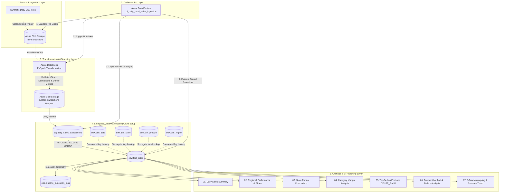

# Architecture & Data Pipeline Overview

## High-Level Architecture Diagram

---

## Architectural Breakdown

### 1. Ingestion Layer (Azure Blob Storage)
- Stores daily incoming sales transactions in CSV format: `daily_transactions_YYYYMMDD.csv`.
- Serves as the immutable raw landing zone.

### 2. Orchestration Layer (Azure Data Factory)
- Coordinates and monitors execution dependencies.
- Handles automated daily schedule triggering, parameter injection, activity retries, and error notifications.

### 3. Transformation & Cleaning Layer (Azure Databricks / PySpark)
- **Schema Enforcement & Casting**: Explicit PySpark schema preventing schema drift.
- **Data Cleansing**: Trimming strings, coalescing null discounts to `0.00`, standardizing date formats.
- **Quality Filtering**: Drops invalid quantities (`quantity <= 0`), negative unit prices, and unrecognized transaction statuses.
- **Deduplication**: Eliminates duplicate `transaction_id` occurrences using window partitioning.
- **Derived Metrics**: Calculates `gross_amount` and `net_amount` (`(quantity * unit_price) - discount`).
- **Curated Export**: Persists clean data in partitioned Snappy-compressed Parquet files.

### 4. Enterprise Data Warehouse Layer (Azure SQL Database)
- **Staging Table (`stg.daily_sales_transactions`)**: High-throughput transient holding area loaded directly from Parquet.
- **Dimensional Star Schema (`edw`)**:
  - `dim_date`: Calendar lookup for time-intelligence reporting.
  - `dim_region`: Geographic hierarchy and regional manager attribution.
  - `dim_store`: Store location, format (Flagship/Standard/Outlet), and regional mapping.
  - `dim_product`: Product catalog, hierarchy, category, and standard unit costs.
  - `fact_sales`: Granular transaction fact table holding quantities, revenues, discounts, and foreign keys.
- **Idempotent Upsert (`ops.usp_load_fact_sales`)**: Uses SQL `MERGE` to prevent duplicate transaction entries when pipeline batches re-run.
- **Operational Auditing (`ops.pipeline_execution_logs`)**: Records row counts, pipeline run IDs, status, and execution duration.

### 5. BI Reporting Layer (SQL Analytics & Power BI)
- Modular analytical queries demonstrating standard business reporting metrics.
- Uses Common Table Expressions (CTEs), Aggregations, Conditional `CASE` expressions, and Analytical Window Functions (`ROW_NUMBER`, `DENSE_RANK`, `LAG`, `AVG() OVER`).
