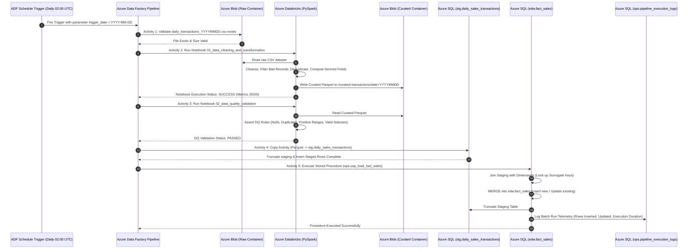

# Data Pipeline Flow & Execution Lifecycle

## End-to-End Execution Sequence Diagram

---

## Detailed Pipeline Phases

### Phase 1: File Ingestion & Pre-Condition Validation
- **Trigger**: The pipeline is triggered on a daily cadence or manually with parameter `trigger_date` (format: `YYYY-MM-DD`).
- **Validation**: ADF executes a `Validation` activity to verify the daily file `daily_transactions_YYYYMMDD.csv` has landed in the `raw-transactions` container and is non-empty.

### Phase 2: Distributed PySpark Data Transformation
- ADF triggers the Databricks notebook activity.
- The PySpark job executes the following transformations:
  1. Reads raw CSV with explicit `raw_schema`.
  2. Trims all string columns to avoid whitespace matching issues.
  3. Coalesces `NULL` discounts to `0.00`.
  4. Filters out corrupt rows: missing IDs, `quantity <= 0`, negative `unit_price`, and unsupported `transaction_status`.
  5. Deduplicates records on `transaction_id`.
  6. Calculates derived measures:
     $$\text{gross\_amount} = \text{quantity} \times \text{unit\_price}$$
     $$\text{net\_amount} = (\text{quantity} \times \text{unit\_price}) - \text{discount}$$
  7. Persists the clean dataset into partitioned Snappy-compressed Parquet files in `curated-transactions/date=YYYYMMDD`.

### Phase 3: Data Quality Gates
- Databricks notebook `02_data_quality_validation` executes automated assertion checks.
- If any critical check fails (e.g., duplicate transaction IDs or negative net amounts), the pipeline terminates immediately before data touches the relational database.

### Phase 4: Staging Copy
- ADF `Copy Activity` performs high-performance bulk loading from Parquet into `stg.daily_sales_transactions`.
- A pre-copy script cleans any residual staging rows.

### Phase 5: Dimensional Modeling & Idempotent Merge
- ADF calls stored procedure `ops.usp_load_fact_sales`.
- Inside the transaction:
  1. Maps natural business keys (`store_id`, `product_id`, `region`) to dimension surrogate keys (`store_key`, `product_key`, `region_id`).
  2. Executes an atomic `MERGE` statement into `edw.fact_sales`.
  3. Emits audit telemetry into `ops.pipeline_execution_logs`.
  4. Commits the transaction and empties the staging table.
