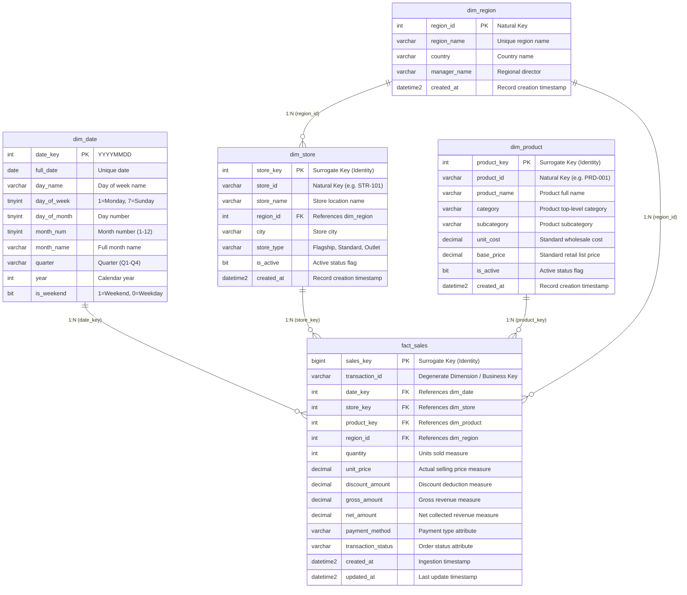

# Data Dictionary & Schema Documentation

This document describes the physical and logical schemas for all staging, dimension, fact, and operational tables in the Azure SQL Data Warehouse.

---

## 1. Dimensional Model Overview

---

## 2. Table Specifications

### 2.1 `edw.dim_date`
Provides a time-dimension lookup table for slicing metrics by date, month, quarter, day of week, or weekend flag.
- **Granularity**: 1 record per calendar day.
- **Primary Key**: `date_key` (Format: `YYYYMMDD`, integer).

| Column Name | Data Type | Nullable | Description |
| :--- | :--- | :--- | :--- |
| `date_key` | `INT` | NO | Primary Key in YYYYMMDD integer format |
| `full_date` | `DATE` | NO | Standard SQL date representation |
| `day_name` | `VARCHAR(15)` | NO | Name of day (e.g., 'Monday', 'Friday') |
| `day_of_week` | `TINYINT` | NO | Integer day of week (1 to 7) |
| `day_of_month`| `TINYINT` | NO | Day number of the month (1 to 31) |
| `month_num` | `TINYINT` | NO | Month number (1 to 12) |
| `month_name` | `VARCHAR(15)` | NO | Name of month (e.g., 'September') |
| `quarter` | `VARCHAR(2)` | NO | Quarter string ('Q1', 'Q2', 'Q3', 'Q4') |
| `year` | `INT` | NO | Four-digit calendar year |
| `is_weekend` | `BIT` | NO | 1 for Saturday/Sunday, 0 for weekdays |

---

### 2.2 `edw.dim_region`
Stores geographical regional groupings and sales leadership attribution.
- **Granularity**: 1 record per operational sales region.
- **Primary Key**: `region_id` (`INT`).

| Column Name | Data Type | Nullable | Description |
| :--- | :--- | :--- | :--- |
| `region_id` | `INT` | NO | Primary natural key identifier |
| `region_name`| `VARCHAR(50)` | NO | Unique regional title |
| `country` | `VARCHAR(50)` | NO | Country name |
| `manager_name`| `VARCHAR(100)`| NO | Assigned Regional General Manager |
| `created_at` | `DATETIME2` | NO | Creation timestamp |

---

### 2.3 `edw.dim_store`
Stores physical retail store locations, formats, and regional linkages.
- **Granularity**: 1 record per retail store.
- **Primary Key**: `store_key` (`INT IDENTITY`).

| Column Name | Data Type | Nullable | Description |
| :--- | :--- | :--- | :--- |
| `store_key` | `INT` | NO | Auto-incrementing surrogate primary key |
| `store_id` | `VARCHAR(20)` | NO | Business store code (e.g., 'STR-101') |
| `store_name` | `VARCHAR(100)`| NO | Physical retail store name |
| `region_id` | `INT` | NO | Foreign Key referencing `edw.dim_region` |
| `city` | `VARCHAR(50)` | NO | City location |
| `store_type` | `VARCHAR(30)` | NO | Store format: Flagship, Standard, Outlet |
| `is_active` | `BIT` | NO | Active operational status |
| `created_at` | `DATETIME2` | NO | Record creation timestamp |

---

### 2.4 `edw.dim_product`
Stores SKU details, product hierarchy, category, and wholesale costs.
- **Granularity**: 1 record per catalog product SKU.
- **Primary Key**: `product_key` (`INT IDENTITY`).

| Column Name | Data Type | Nullable | Description |
| :--- | :--- | :--- | :--- |
| `product_key`| `INT` | NO | Auto-incrementing surrogate primary key |
| `product_id` | `VARCHAR(20)` | NO | Catalog SKU code (e.g., 'PRD-001') |
| `product_name`| `VARCHAR(150)`| NO | Full product display name |
| `category` | `VARCHAR(50)` | NO | Top-level product category |
| `subcategory`| `VARCHAR(50)` | NO | Secondary product taxonomy |
| `unit_cost` | `DECIMAL(10,2)`| NO | Standard wholesale unit cost |
| `base_price` | `DECIMAL(10,2)`| NO | Standard MSRP / list price |
| `is_active` | `BIT` | NO | Active catalog status |
| `created_at` | `DATETIME2` | NO | Record creation timestamp |

---

### 2.5 `edw.fact_sales`
Central sales transaction fact table holding granular line-item metrics.
- **Granularity**: 1 record per completed/processed retail transaction item.
- **Primary Key**: `sales_key` (`BIGINT IDENTITY`).

| Column Name | Data Type | Nullable | Description |
| :--- | :--- | :--- | :--- |
| `sales_key` | `BIGINT` | NO | Auto-incrementing surrogate primary key |
| `transaction_id` | `VARCHAR(50)` | NO | Business transaction ID (Degenerate Dimension) |
| `date_key` | `INT` | NO | FK to `edw.dim_date` |
| `store_key` | `INT` | NO | FK to `edw.dim_store` |
| `product_key`| `INT` | NO | FK to `edw.dim_product` |
| `region_id` | `INT` | NO | FK to `edw.dim_region` |
| `quantity` | `INT` | NO | Number of items purchased ($> 0$) |
| `unit_price` | `DECIMAL(10,2)`| NO | Unit selling price applied |
| `discount_amount` | `DECIMAL(10,2)`| NO | Total promotional discount applied |
| `gross_amount`| `DECIMAL(10,2)`| NO | Calculated measure: $quantity \times unit\_price$ |
| `net_amount` | `DECIMAL(10,2)`| NO | Calculated measure: $gross\_amount - discount\_amount$ |
| `payment_method` | `VARCHAR(30)` | NO | Payment method (e.g., 'Credit Card', 'Cash') |
| `transaction_status` | `VARCHAR(30)` | NO | Transaction status ('Completed', 'Cancelled', 'Refunded', 'Failed') |
| `created_at` | `DATETIME2` | NO | Record creation timestamp |
| `updated_at` | `DATETIME2` | NO | Record last modified timestamp |

---

### 2.6 `stg.daily_sales_transactions`
Transient staging table holding daily batch data loaded from curated Parquet files.
- **Granularity**: 1 record per transaction in the incoming batch.
- **Lifecycle**: Truncated prior to ingestion and flushed upon successful merge into `edw.fact_sales`.

---

### 2.7 `ops.pipeline_execution_logs`
Operational audit and pipeline observability table.
- **Granularity**: 1 record per pipeline execution activity.
- **Primary Key**: `log_id` (`INT IDENTITY`).

| Column Name | Data Type | Description |
| :--- | :--- | :--- |
| `log_id` | `INT` | Primary Key |
| `pipeline_name` | `VARCHAR(100)` | Name of ADF pipeline executed |
| `run_id` | `VARCHAR(100)` | Unique ADF execution RunId |
| `trigger_date` | `DATE` | Business date of processed data |
| `step_name` | `VARCHAR(100)` | Executed procedure/step name |
| `rows_inserted` | `INT` | Total newly inserted rows |
| `rows_updated` | `INT` | Total modified/merged rows |
| `rows_rejected` | `INT` | Total rejected/unmatched records |
| `status` | `VARCHAR(20)` | 'SUCCESS', 'FAILED', or 'IN_PROGRESS' |
| `error_message` | `NVARCHAR(MAX)`| Detailed SQL / execution error message |
| `start_time` | `DATETIME2` | Step start timestamp |
| `end_time` | `DATETIME2` | Step completion timestamp |
| `execution_duration_sec` | `INT` | Execution duration in seconds |
